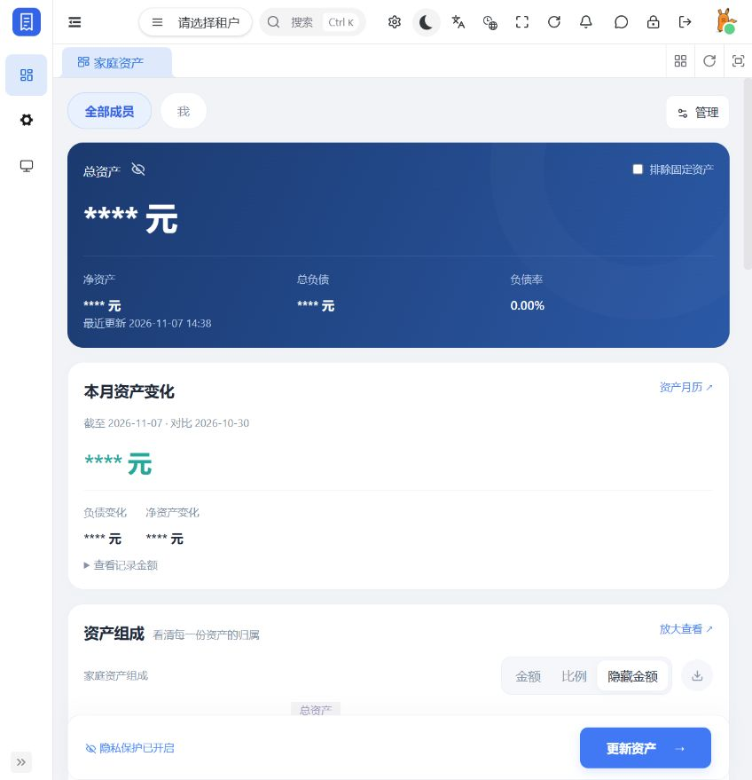
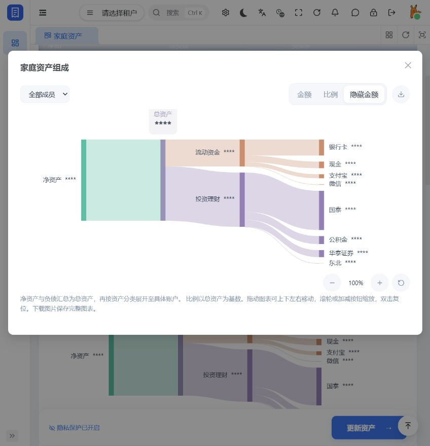
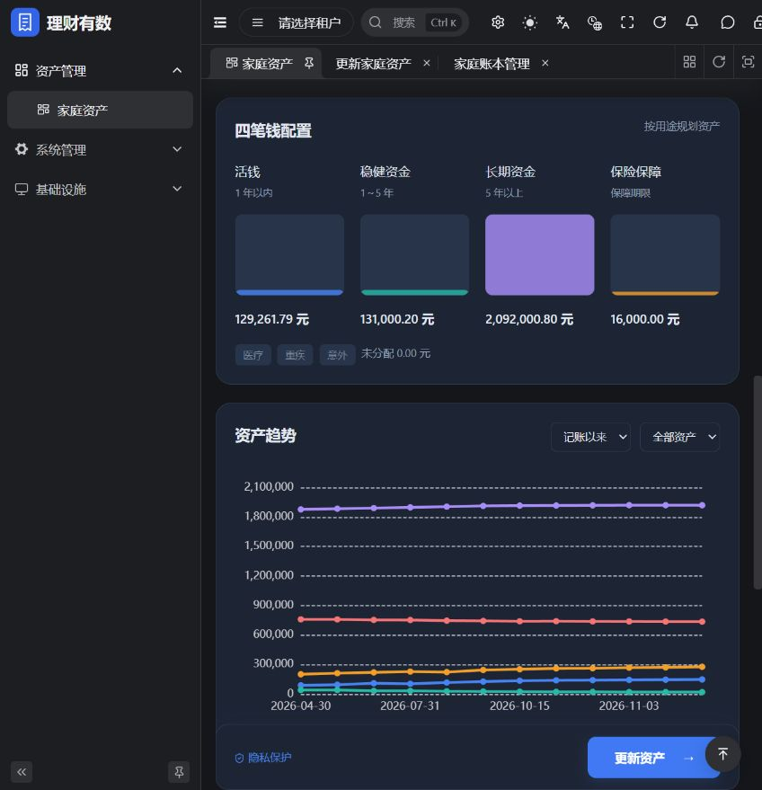
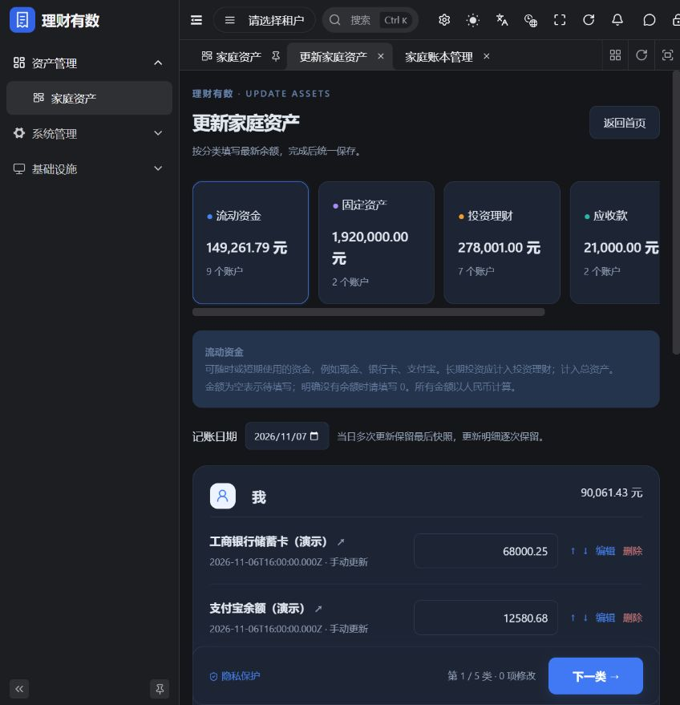

# 理财有数 · Financial UI

理财有数的 Web 前端，基于 Vue 3、TypeScript、Vben 5 和 Ant Design Vue，用于管理家庭资产、负债、成员和资产变化。

[后端仓库与完整部署说明](https://github.com/MonochromeCode/financial) · [家庭资产接口](https://github.com/MonochromeCode/financial/blob/main/financial-server/docs/assets.md)

## 页面预览

以下为 2026-11-07 本地运行的最新页面，截图已开启金额隐私保护。

### 家庭资产首页



<details>
<summary>查看可拖动、缩放的资产组成桑基图</summary>



</details>

<details>
<summary>查看四笔钱配置与资产趋势</summary>



</details>

<details>
<summary>查看资产更新页面</summary>



</details>

## 功能

- 家庭总览与成员筛选：资产、负债、净资产、负债率、月度变化；顶部采用紧凑工具栏，成员筛选和管理入口同排展示。
- 历史金额明细：点击“查看记录金额”弹出明细表，显示全部历史记账日期，以银行卡、现金、支付宝等账户为列，并列出总资产、总负债、净资产；同日取最后余额，未修改账户沿用上次余额，支持横纵滚动和固定表头、日期列。
- 资产组成桑基图：净资产/总负债 → 总资产 → 资产分类 → 具体账户，使用真实账户明细，支持金额/比例切换、隐藏金额、成员筛选、整图平移缩放、放大查看和完整图表 PNG 下载。
- 五类资产编辑：流动资金、固定资产、投资理财、应收款、负债。
- 四笔钱配置、资产组成、趋势图、月历和更新明细。
- 家庭账本管理：家庭成员、查看权限、资产分类配置。
- 字典选项：账户模板、资金用途、保险类型、操作及来源标签统一读取后端 `context.options`，由系统字典维护；停用选项保留历史展示并禁止新选。
- Excel 导出：首页“导出”下载资产汇总、与“查看记录金额”一致的账户明细和历史账户明细，历史包含全部新增、修改、删除及导入记录，不受页面分页限制；遵循当前成员、排除固定资产和金额隐藏状态，空余额保留为“待填写”，大额金额以文本保留精度。
- 桌面与移动端 H5 适配、深浅主题、金额隐藏、编辑草稿恢复。

本仓库保留 Vben monorepo 结构，理财有数业务位于 `apps/web-antd`。当前提供家庭资产负债表功能，银行自动同步、日常消费流水和原生 App 尚未实现。

### 桑基图操作

- 按住鼠标左键或用单指拖动，向上下左右平移整张图。
- 在图表内滚动滚轮，围绕鼠标位置缩放；也可点击加减按钮，缩放范围为 50%～300%。
- 双击图表或点击复位按钮，恢复 100% 和初始位置。
- 聚焦图表后，方向键平移，`+` / `-` 缩放，`0` / `Home` 复位。
- 首页和“放大查看”弹窗都支持上述操作；下载保存完整图表，不受当前平移缩放裁切影响。

## 环境要求

| 工具 | 版本 |
| --- | --- |
| Node.js | `^22.18.0` 或 `^24.12.0`，推荐 Node.js 24 |
| pnpm | `11.16.0`，与 `packageManager` 保持一致 |
| 后端 | [financial](https://github.com/MonochromeCode/financial)，默认 `http://127.0.0.1:48080` |

## 启动

```shell
git clone https://github.com/MonochromeCode/financial-ui.git
cd financial-ui
pnpm install
pnpm --filter @vben/web-antd exec vite --mode development --port 5173
```

访问 <http://localhost:5173>。使用 `pnpm dev:antd` 时默认端口为 `5666`；终端输出的地址为准。

开发接口配置在 `apps/web-antd/.env.development`。如需覆盖，在同目录创建 Git 已忽略的 `.env.development.local`：

```dotenv
VITE_PORT=5173
VITE_BASE_URL=http://127.0.0.1:48080
VITE_GLOB_API_URL=/admin-api
```

先按后端 README 初始化数据库并启动服务。默认初始化账号为 `admin` / `admin123`，首次进入家庭资产页建立账本。演示数据通过后端 `script/seed-household-demo.ps1` 生成。

## 构建与检查

```shell
pnpm build:antd
pnpm --filter @vben/web-antd typecheck
pnpm exec vitest run apps/web-antd/src/views/finance/__tests__/shared.test.ts --dom
pnpm exec vitest run apps/web-antd/src/views/finance/__tests__/asset-composition.test.ts
pnpm exec vitest run apps/web-antd/src/views/finance/__tests__/chart-viewport.test.ts
```

构建输出目录为 `apps/web-antd/dist`，部署前按环境配置 API 地址。

桑基图及视口交互的 12 项单元测试覆盖四层流向、同名账户、金额精度、比例、负债守恒、负净资产、空账本、缩放中心与边界、指针拖动及键盘操作。图表依赖总览接口的 `accounts` 字段；部署时同步更新后端，确保真实账户明细随成员筛选返回。

## 业务代码

```text
apps/web-antd/
├── public/logo.svg
└── src/
    ├── api/finance/assets.ts          家庭资产接口
    ├── router/routes/modules/dashboard.ts
    └── views/finance/
        ├── index.vue                 家庭资产首页
        ├── edit.vue                  更新家庭资产
        ├── manage.vue                家庭账本管理
        ├── asset-chart.vue           资产图表
        ├── asset-composition-chart.vue 资产组成桑基图与图片下载
        ├── asset-composition.ts      账户流向、金额和比例计算
        ├── use-chart-viewport.ts     图表平移、缩放与复位交互
        ├── shared.ts                 金额与共享逻辑
        ├── use-asset-dictionaries.ts 后端字典选项与标签
        └── finance.css               页面样式
```

| 页面         | 路由                     |
| ------------ | ------------------------ |
| 家庭资产首页 | `/dashboard/workspace`   |
| 更新家庭资产 | `/finance/assets/edit`   |
| 家庭账本管理 | `/finance/assets/manage` |

后端金额使用十进制字符串返回，前端即时汇总使用整数分。权限由后端校验，页面按当前用户的家庭范围展示数据。

月度对比取最近快照与该快照所在月份之前的最后一次快照；无基准时提示首次记录，无快照时显示暂无资产记录。金额对照和桑基图均遵循成员筛选、排除固定资产及金额隐私状态。已有 Excel 导入记录按数据日期展示，并保留来源标识。

## 许可与来源

基于 [yudao-ui-admin-vben](https://github.com/yudaocode/yudao-ui-admin-vben) 和 [Vue Vben Admin](https://github.com/vbenjs/vue-vben-admin) 开发，遵循 [MIT License](LICENSE)，保留上游版权声明。
